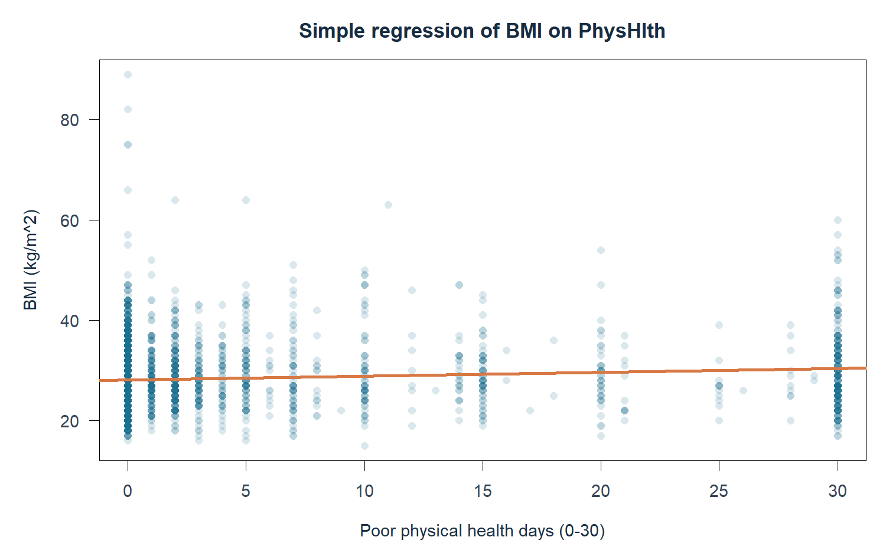
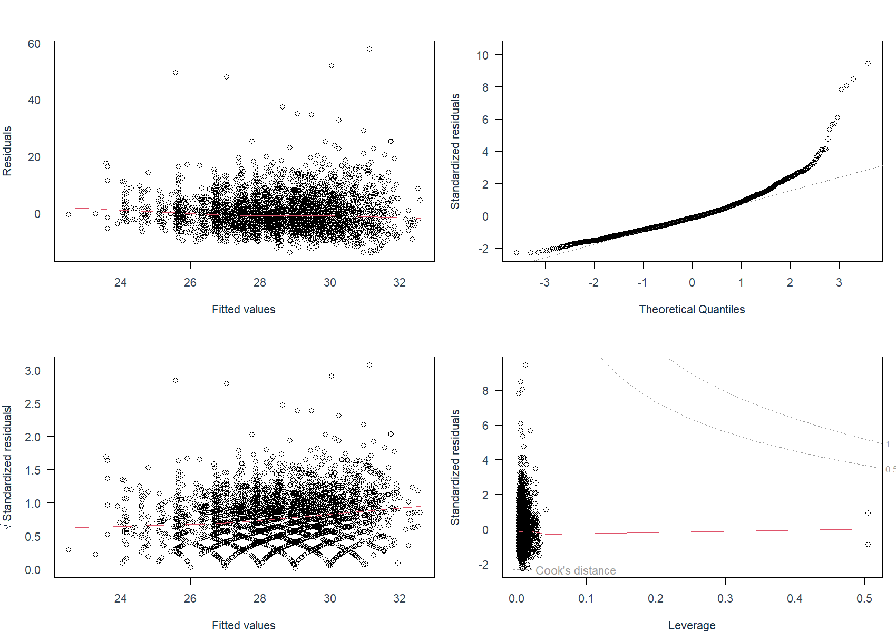

# Understand the entire project: a beginner's guide for the faculty review

**Project:** Statistical analysis of diabetes and lifestyle indicators

**Course:** BMAT202P Probability and Statistics Lab

**Guide updated:** 12 October 2026

This guide explains **the intro and all twelve numbered content slides**, including the theory, actual calculations, reasons for choosing each method, and how to answer faculty questions. It is deliberately much longer than the presentation. The deck has one intro plus twelve content slides. Labs 7–8 are on content slide 8, Lab 9 is on content slide 9, Lab 10 is on content slide 10, Lab 11 is on content slide 11, and the expanded conclusion is final content slide 12. Each slide identifies the course exercise at the top.

Project numbers come from the saved R outputs. Small invented numbers used to explain a formula are labelled **teaching example**. The [short slide text and speaker notes](slide_content_and_notes.md) are saved separately, so rebuilding the presentation will not overwrite this study guide.

## How to study this guide

Read the foundations first and then follow the slides in order. For every slide, learn **the question, the data, the method, the result, and its meaning**. Understand the idea before memorizing its formula. Close the guide and explain each slide aloud using the suggested speaking sentence. Finally, answer the review questions without looking at the answers.

## Contents

- [Foundations: statistics from zero](#foundations-statistics-from-zero)
- [Intro: what the project is](#intro-what-the-project-is)
- [Slide 1: dataset and aim](#slide-1-dataset-and-aim)
- [Slide 2: data preparation](#slide-2-data-preparation)
- [Slide 3: outlier analysis and removal](#slide-3-outlier-analysis-and-removal)
- [Slide 4: summary statistics and graphs](#slide-4-summary-statistics-and-graphs)
- [Slide 5: correlation and simple regression](#slide-5-correlation-and-simple-regression)
- [Slide 6: multiple regression and model checks](#slide-6-multiple-regression-and-model-checks)
- [Slide 7: fitting probability distributions](#slide-7-fitting-probability-distributions)
- [Slide 8: one- and two-sample hypothesis tests](#slide-8-one--and-two-sample-hypothesis-tests)
- [Slide 9: independent and paired t-tests](#slide-9-independent-and-paired-t-tests)
- [Slide 10: chi-square category patterns and relationships](#slide-10-chi-square-category-patterns-and-relationships)
- [Slide 11: CRD, RBD and Latin Square using health records](#slide-11-crd-rbd-and-latin-square-using-health-records)
- [Slide 12: findings and conclusion](#slide-12-findings-and-conclusion)
- [R implementation and file map](#r-implementation-and-file-map)
- [Every original drawing explained](#every-original-drawing-explained)
- [Review questions and answer key](#review-questions-and-answer-key)
- [What to revise just before the review](#what-to-revise-just-before-the-review)
- [References and evidence](#references-and-evidence)

## Foundations: statistics from zero

### Observations, variables and the purpose of statistics

Statistics helps organize observations, describe patterns and assess uncertainty. **Descriptive statistics** summarize what we observed: counts, averages and graphs. **Inferential statistics** use data and assumptions to assess a wider claim: a difference between means, an association, or a probability pattern.

A dataset is a table. A row is one observation; a column, or variable, records one characteristic. In the survey a row is a respondent. In an agricultural experiment a row is a plot of land. Always know what one observation represents before choosing a method.

### Population, sample, statistic and parameter

A population is the group we want to understand. A sample is the subset studied. A parameter describes a population; a statistic is calculated from a sample. Our mean BMI is a sample statistic, while a true population mean would be a parameter.

CDC's original survey, the processed 253,680-row derivative, and our 3,000-row working sample are three different levels of data. Their sizes are not interchangeable.

### Numerical and categorical variables

| Type | Meaning | Project example | Consequence |
|---|---|---|---|
| Continuous numerical | A measurement that can conceptually take intermediate values | BMI, recorded as integers in this file | Mean, variance and regression are meaningful |
| Discrete numerical | A count | Physical poor-health days, 0–30 | A count model is worth checking, but may fail |
| Nominal categorical | Named groups without numerical order | Sex; yes/no smoking indicator | Compare groups or proportions |
| Ordinal categorical | Groups with an order | Age bands, education, income, general health | Order matters; equal spacing is not guaranteed |
| Identifier | A label used to trace a record | `source_row` | Not a health predictor |

A category coded with a number is still a category. Age code 7 means 50–54 years, not seven years old.

### Models and assumptions

A model is a simplified mathematical description of a pattern. Regression estimates an average response from predictors. A probability distribution describes how likely different values are. A model may fit poorly; detecting and explaining that failure is a valid result.

An assumption is a condition needed for a method to work as intended, such as independent observations or similar error spread. Software can calculate a result even when assumptions are questionable. We therefore examine the design and diagnostic graphs.

### Association, causation and confounding

Association means characteristics vary together. Causation means changing one produces a change in another. A survey association alone does not establish causation.

**Teaching example:** age might relate to both BMI and poor-health days. Age could partly explain a relationship between the other two variables. A third factor influencing a comparison is a possible **confounder**. Regression can adjust for measured factors; it cannot automatically remove every confounder.

### Standard deviation, standard error and sampling variation

Different samples usually give different averages: this is sampling variation. **Standard deviation (SD)** describes variation between individual observations. **Standard error (SE)** describes uncertainty in an estimate, such as the sample mean.

For a mean, `SE = SD / sqrt(n)`. Our BMI SD is 6.3514 and n is 3,000, so the mean's SE is about **0.116**. Individuals vary substantially, while the average is estimated more precisely. A larger sample reduces sampling uncertainty; it does not fix biased measurement or a wrong model.

### Hypotheses, p-values and significance

The **null hypothesis**, H0, states the reference claim being tested, often no difference or no association. The **alternative**, H1, states the competing claim. A two-sided test considers differences in either direction.

A test statistic measures departure from H0 on the test's scale: for example t, chi-square or F. A **p-value** is the probability, assuming H0 and the test assumptions are true, of a result at least as extreme as the observed one.

Our threshold is **alpha = 0.05**. If `p < 0.05`, reject H0 at this threshold. Otherwise, fail to reject it. Failing to reject does not prove H0 is true. A p-value is not the probability that H0 is true, not the probability that the result “happened by chance”, and not the size of an effect.

Statistical significance concerns evidence against H0. Practical importance concerns the magnitude and usefulness of the result. A small association can be statistically detectable with a large sample and still have little explanatory power.

Under suitable assumptions, alpha 0.05 gives a procedure that rejects a true null about 5% of the time over repeated use: a **Type I error**. Missing a real difference is a **Type II error**. **Power** is the ability to detect a real difference. These do not tell us with certainty whether one particular result is right.

A printed `p = 0` may reflect numerical underflow or rounding. Say **p < 0.001**, not that the true probability is exactly zero.

### Confidence intervals and degrees of freedom

A confidence interval expresses uncertainty about an estimate. A 95% procedure covers the true parameter in about 95% of repeated samples under its assumptions. It does not mean that 95% of individual people lie inside that interval.

Our 95% interval for average BMI is **28.17–28.63**. This is about the mean, not the range of individual BMIs.

Degrees of freedom, df, roughly count independent information left after constraints or fitted quantities. If three counts must add to a fixed total, choosing two determines the third. Estimating a mean leaves `n − 1` df for sample variance. Each test has its own df formula.

### Percent and percentage points

Proportion `0.1563` means `15.63%`. A difference between `17.36%` and `14.09%` is **3.27 percentage points**. A relative percentage increase instead divides the difference by the starting value.

### Symbols and formulas without fear

| Symbol | Read it as |
|---|---|
| n or N | Number of observations/trials; the surrounding formula specifies which |
| x, y | Variable values; X and Y often name the corresponding random variables |
| x-bar or sample mean | Average calculated from observed data |
| mu, μ | Population/model mean |
| sigma, σ | Population/model standard deviation |
| s, s² | Sample SD and sample variance |
| beta, β | Regression coefficient |
| lambda, λ | Poisson rate/mean |
| alpha, α | Chosen test threshold, here 0.05 |
| sum(...) or Σ | Add the indicated quantities across observations/categories |
| sqrt(...) | Square root, the inverse of squaring |
| exp(z) | e raised to power z; e is approximately 2.718 |
| k! | Factorial: multiply integers 1 through k; 0! is defined as 1 |
| choose(n,k) | Number of ways to choose k items from n: n! / (k! × (n−k)!) |

**Teaching example:** `choose(3,2) = 3`, because two successes among three positions can be arranged as success-success-failure, success-failure-success, or failure-success-success.

The letter p needs context: binomial **p = 0.156** is an event probability, whereas **test p = 0.962** is a p-value assessing a null. They are not interchangeable.

Several distributions describe the **test statistic under H0**, rather than the original observations. The t reference accounts for estimating an unknown SD. Chi-square describes certain squared standardized discrepancies. F describes an appropriate ratio of variance estimates. A t-test does not claim the raw BMI values follow a t distribution, and an F-test does not claim yields themselves follow an F distribution. Software uses the reference distribution and df to calculate tail probabilities.

## Intro: what the project is

We apply the full lab sequence using R. The main health dataset supports summaries, graphs, correlation, regression, distribution fitting and group comparisons. Separate published datasets demonstrate methods that require a different observation structure or experimental design.

Our regression predicts **BMI**. Diabetes status is used in summaries and categorical comparisons. We have not built a diabetes classifier, assessed diagnostic accuracy, or developed a clinical recommendation.

**Say it simply:** “We use health survey data to study BMI and health patterns, then apply our course methods. Separate published experiments demonstrate paired measurements and experimental designs.”

## Slide 1: dataset and aim

**Exercise header:** LAB 1: Data types, import and export (dataset overview)

### Question, source and suitability

We want to describe health patterns, examine BMI relationships, compare groups and demonstrate the statistical methods taught in the course.

BRFSS stands for **Behavioral Risk Factor Surveillance System**, the CDC health survey. We use Alex Teboul's processed 2015 derivative from Kaggle. This is **secondary data collection**: obtaining and documenting existing data rather than collecting new responses ourselves.

The exact derivative contains **253,680 rows and 22 raw columns**: 21 health/lifestyle predictors plus `Diabetes_012`. Added preparation columns do not change the number of original columns. We randomly select **3,000 rows without replacement** for a manageable course analysis.

This dataset is suitable because it contains numerical measurements, counts, binary indicators and grouped categories. It does not provide before/after measurements on the same people or the randomized agricultural designs needed for later demonstrations.

### Health status and BMI

| Status code | Meaning | Sample count | Percentage |
|---|---|---:|---:|
| 0 | No diabetes | 2,531 | 84.37% |
| 1 | Prediabetes | 48 | 1.60% |
| 2 | Diabetes | 421 | 14.03% |

The derived binary variable combines codes 1 and 2: `(48 + 421) / 3000 = 469 / 3000 = 15.63%`. **Positive means prediabetes OR diabetes**. Do not call all 469 people diagnosed diabetes. It is our category definition, not a test we administered.

BMI means **body mass index**: weight in kilograms divided by height in metres squared. The dataset already supplies BMI; our scripts do not calculate it from height and weight. Its unit is `kg/m²`.

### Reading the slide and justifying sampling

The three large numbers describe source size, sample size and predictor count. The bar chart's x-axis contains health-status groups; its y-axis counts people. Most sampled respondents belong to “No diabetes”. Unequal group sizes are not automatically an error.

`PhysHlth` counts days in the past 30 days when physical health was not good. `MentHlth` is the mental-health counterpart. The table introduces these and the other key variable types.

The 3,000-row sample is a practical choice, not a proven optimal size. Sampling without replacement prevents selecting the same source row twice. `set.seed(101)` makes the selection reproducible in the same computational setup. It does not make the original survey unbiased.

The full derivative's combined-positive percentage is about **15.76%**, close to our sample's **15.63%**. Similarity is a useful check, not proof of national representativeness. The derivative does not preserve complete survey weights/design information, so we describe sample patterns rather than national prevalence.

### R implementation

```r
full$Diabetes_binary <- ifelse(full$Diabetes_012 > 0, 1, 0)
set.seed(101)
df <- full[sample.int(nrow(full), 3000), ]
```

`ifelse()` defines the event; `sample.int()` selects row positions. The script also checks expected source size and column names. A source checksum helps detect whether the input file changed.

**Evidence:** [setup script](../Lab00_Setup/00_setup.R), [class counts](../Lab00_Setup/output/class_balance.csv), [provenance](../data/provenance.json).

**Say it simply:** “We sampled 3,000 respondents from a documented 253,680-row health dataset. We study BMI and lifestyle patterns; 469 sampled people report prediabetes or diabetes.”

**Faculty may ask:** “Did you collect these responses?” Answer: “No. We obtained an existing public dataset and documented its source and preparation.”

## Slide 2: data preparation

**Exercise header:** LAB 1: Data types, import and export

### What we check and why

The sequence is **import → sample → validate → assign labels/types → export**. Preparation includes understanding the codes, not only deleting rows.

Binary indicators must be 0 or 1; status 0–2; general health 1–5; education 1–6; income 1–8; and age 1–13. Mental and physical days must have allowed integer codes 0–30. BMI must be finite and positive.

There are **zero missing cells and zero invalid records**, so all 3,000 rows remain after validation. We do not claim to have imputed missing values: no replacement was needed. These checks establish compatibility with the expected format, not perfect truthfulness of every self-reported response.

### Factors, labels and ordinal codes

A **factor** is R's category representation. Codes become readable levels: “Female”/“Male”, “No”/“Yes”, and three health-status labels.

Age, education and income have an ordered meaning, but regression represents them as category contrasts. Treating age code as a continuous number would assume equal spacing and one fixed effect per code. The bands include 18–24 and 80+, so that assumption is inappropriate.

General health is explicitly an ordered factor from Excellent through Poor. BMI and day counts remain numerical. Data types follow meaning, not simply whether the imported file contains digits.

`Smoker = Yes` means **ever smoked at least 100 cigarettes**, not necessarily currently smoking. `PhysActivity = Yes` indicates reported physical activity in the past 30 days apart from the regular job; it is not exercise duration.

### Repeated profiles, tracing and file formats

Thirteen sampled records repeat recorded feature combinations. Different people can have identical age bands, BMI and yes/no answers. We retain them because repeated features do not prove duplicate people.

`source_row` records the source row position, so we can trace sampled or removed records. It is not a patient identity or predictor.

CSV is a portable text table; RDS preserves R types and factor levels. We save both. **Clean means validated and typed**, not “every statistical outlier removed”. The BMI-filtered sensitivity file is separate.

```r
df <- read.csv("data/brfss_sample.csv")
df$Sex <- factor(df$Sex, levels = 0:1, labels = c("Female", "Male"))
saveRDS(df, "data/brfss_clean.rds")
write.csv(df, "data/brfss_clean.csv", row.names = FALSE)
```

`$` accesses a column. Validation happens before category conversion so invalid codes can be reported rather than silently becoming missing factor values.

**Evidence:** [preparation script](../Lab01_Data_Types/01_data_types.R), [dictionary](../Lab01_Data_Types/output/variable_dictionary.csv), [missingness](../Lab01_Data_Types/output/missingness.csv).

**Say it simply:** “We checked missing entries, codes and ranges, then assigned readable categories and correct types. All 3,000 rows passed.”

**Faculty may ask:** “Why retain repeated rows?” Answer: “Identical recorded features are possible for different people. We had no evidence that they represented duplicate respondents.”

## Slide 3: outlier analysis and removal

**Exercise header:** LAB 1 EXTENSION: Data preparation and outlier analysis

### What an outlier is

An outlier is unusually far from the main body of values according to a stated rule. It could be an error or a valid rare observation. Detection does not automatically justify deletion.

Q1 is the 25th percentile; Q3 is the 75th percentile. Their difference, the **interquartile range**, describes the middle half's spread.

```text
Q1 = 24; Q3 = 31
IQR = 31 − 24 = 7
Lower fence = 24 − 1.5 × 7 = 13.5
Upper fence = 31 + 1.5 × 7 = 41.5
```

BMI below 13.5 or above 41.5 is flagged. All **114 flags** are above the upper fence: **3.8%** of the sample. Removing them leaves **2,886 rows**.

The 1.5×IQR rule is an exploratory convention, not a medical threshold or probability test. It is useful because the middle-half spread is less sensitive to extreme values than a mean-based rule.

### Results and the removal policy

| Measure | All validated rows | BMI-filtered rows |
|---|---:|---:|
| Respondents | 3,000 | 2,886 |
| Mean BMI | 28.40 | 27.65 |
| BMI SD | 6.35 | 4.96 |
| BMI variance | 40.34 | 24.59 |
| Combined-positive share | 15.63% | 14.62% |
| BMI–physical-days correlation | 0.102 | 0.056 |
| Simple regression R² | 1.03% | 0.31% |

High values pull the mean upward and increase spread. Removing them also changes the sample's health-status composition and weakens the observed correlation. Removal therefore changes who is represented, not just the appearance of a graph.

This is a **sensitivity analysis**: compare results under a different handling choice. Our primary analysis retains valid extreme values; the separate file demonstrates actual removal and its consequences. Later primary results, including mean 28.40 and multiple R² 6.81%, use all 3,000 validated rows.

### Reading the graphs

The histogram shows BMI horizontally and respondent count vertically. Dashed fences mark the rule. The right tail lies beyond the upper fence.

The boxplot box spans Q1–Q3 and its line marks the median. Whiskers reach observed values within the fences, not necessarily the fence values themselves. Values beyond the whiskers appear as individual points. Compare both the central box and the extreme points before/after.

Do not apply IQR deletion blindly to every variable. Yes/no categories have no meaningful numerical tail; small education groups are not errors; zero-heavy counts can have a small or zero IQR and many legitimate flagged values.

```r
q <- quantile(df$BMI, c(.25, .75))
flag <- df$BMI < q[1] - 1.5 * diff(q) |
        df$BMI > q[2] + 1.5 * diff(q)
filtered <- df[!flag, ]
```

`|` means “or”; `!flag` means not flagged. The script also saves a ledger recording which source rows were flagged.

**Evidence:** [outlier script](../Lab01B_Outlier_Analysis/01b_outlier_analysis.R), [comparison](../Lab01B_Outlier_Analysis/output/before_after.csv), [ledger](../Lab01B_Outlier_Analysis/output/outlier_ledger.csv).

**Say it simply:** “The IQR rule flags 114 high BMI values. Removing them lowers the mean and spread, so we show both samples. An unusual value is not automatically a mistake.”

**Faculty may ask:** “Why does the next slide still use mean 28.40?” Answer: “The full validated sample is our primary analysis; removal is demonstrated separately as a sensitivity comparison.”

## Slide 4: summary statistics and graphs

**Exercise header:** LAB 2: Summary statistics and graphical representations

### Centre and spread

The **mean** adds values and divides by their number: `sum(x) / n`. The **median** is the middle sorted value; for an even count it averages the two middle values. The mean is sensitive to extremes; the median is less affected.

**Teaching example:** values 2, 3, 4 have mean and median 3. Values 2, 3, 40 have mean 15 but median 3. A few large values can change the average substantially.

The **mode** is the most frequent value/category. Our numerical table focuses on mean, median, SD and variance. We should not claim a separately computed mode column that does not exist.

Sample variance is `s² = sum((x − mean(x))²) / (n − 1)`. Subtracting the mean gives deviations; squaring prevents positive and negative deviations cancelling. Estimating the mean uses one df, so `n − 1` gives the usual sample-variance correction under independent sampling assumptions.

Standard deviation is `s = sqrt(s²)`, returning spread to the original units. BMI SD is in `kg/m²`; BMI variance is in squared BMI units. IQR is an alternative measure using the middle half.

### Actual numerical results

| Variable | Mean | Median | SD | Variance | Range |
|---|---:|---:|---:|---:|---|
| BMI | 28.40 | 27 | 6.35 | 40.34 | 15–89 |
| Mental poor-health days | 3.26 | 0 | 7.39 | 54.67 | 0–30 |
| Physical poor-health days | 4.15 | 0 | 8.62 | 74.24 | 0–30 |

BMI's mean exceeds its median, consistent with the long right tail. Day counts have median zero but positive means: many report zero days while some report many. SD exceeding the mean is possible and not an error.

Do not say “about 68% lie within one SD” without an appropriate normal approximation. Our BMI distribution is not well described by a normal curve.

### Why different graphs are used

| Graph | Purpose | How to read it |
|---|---|---|
| Histogram | Clustering of numerical values | Adjacent intervals on x; counts on y |
| Bar chart | Category sizes | Bar length represents count; categories are separate |
| Pie chart | Parts of a whole | Slice percentages sum to 100% |
| Density curve | Smoothed numerical shape | Total area is 1; area over an interval represents probability-like mass |
| Boxplot | Compare centre, spread and unusual values | Median, quartile box, whiskers and individual extreme points |

Density height is not the percentage of people at one exact BMI. Probability over a numerical interval is represented by area. A histogram overlaid with a density curve uses a density y-axis, which explains `freq = FALSE` in the normal-fit plot.

Education counts are **2, 49, 105, 778, 834 and 1,232** from no school through college graduate. The smallest category has only two people, so estimates involving it are uncertain. The sex split is **1,667 female (55.6%)** and **1,333 male (44.4%)** respondents.

### BMI by health status

| Status | n | Mean BMI | 95% interval for the mean |
|---|---:|---:|---|
| No diabetes | 2,531 | 27.72 | 27.49–27.95 |
| Prediabetes | 48 | 32.85 | 30.71–35.00 |
| Diabetes | 421 | 31.98 | 31.29–32.68 |

The prediabetes mean is highest in this sample but based on only 48 respondents, with more uncertainty. It does not establish that prediabetes always has higher BMI than diabetes. Individual values overlap across groups, so group means cannot diagnose each person.

```r
mean(df$BMI)
median(df$BMI)
sd(df$BMI)
var(df$BMI)
table(df$Education)
```

The shared `group_summary()` also calculates group-specific SD, variance and t-based intervals for the means.

**Evidence:** [summary script](../Lab02_Summary_Stats/02_summary_stats.R), [numerical summary](../Lab02_Summary_Stats/output/numeric_summary.csv), [group BMI](../Lab02_Summary_Stats/output/bmi_by_status.csv), [frequencies](../Lab02_Summary_Stats/output/frequencies.csv).

**Say it simply:** “We describe centre and spread, using the right graph for each type of data. BMI has a long upper tail, and many people report zero poor-health days.”

**Faculty may ask:** “Why show SD as well as variance?” Answer: “Variance is squared spread; SD is its square root, so it is easier to interpret in the original units.”

## Slide 5: correlation and simple regression

**Exercise header:** LAB 3: Correlation, simple linear regression and R²

### The question and the graph

We ask whether people reporting more poor physical-health days tend to have higher BMI. Let **X = PhysHlth**, the day count, and **Y = BMI**, the response.

Each scatterplot dot is one respondent. Horizontal position is physical poor-health days; vertical position is BMI. Vertical stacks occur because day counts are whole numbers. We use transparent dots to make overlapping observations easier to see. A broad cloud around an almost flat fitted line indicates a weak relationship.



### Covariance: do values move together?

Sample covariance is:

`cov(X,Y) = sum((X − mean(X)) × (Y − mean(Y))) / (n − 1)`

When both values are above their means, or both below, their deviation product is positive. When they are on opposite sides, it is negative. Adding the products measures shared variation.

Our covariance is **5.56** in BMI-units × days. Its positive sign indicates a tendency to move in the same direction. Its magnitude depends on units, so 5.56 by itself is difficult to classify as weak or strong.

### Pearson correlation: covariance on a common scale

`r = cov(X,Y) / (SD(X) × SD(Y))`

Correlation divides by both standard deviations, removing units. Pearson r lies between −1 and +1: negative for an opposite linear direction, positive for the same direction, and near zero for little linear relationship. Zero correlation does not rule out a curved relationship.

Our result is **r = 0.1016**, approximately **0.102**, with a 95% interval **0.066–0.137**. This is a weak positive linear association. The correlation p-value is below 0.001, so a zero association is inconsistent with the simple test model, but the association is still small.

Do not say “10.2% of BMI is explained” because r is 0.102. The explained-variation measure is R², discussed below.

### Why also calculate Spearman correlation?

Spearman correlation calculates correlation using ranks rather than the original magnitudes. It describes a **monotonic** tendency: values broadly increasing or decreasing together, without requiring a straight relationship on the original scale. It is less directly affected by very large numerical values, though it is not immune to all data problems.

Our Spearman result is **0.108**, close to Pearson's 0.102. Both suggest a weak positive association. There are tied day counts, so the R call uses `exact = FALSE`; tied observations receive appropriate ranks rather than pretending all ranks are distinct.

### Simple regression: fit a straight line

“Simple” means one predictor, not that the software calculates only a mean. The model is:

`Y = intercept + slope × X + error`

The fitted prediction is:

`Predicted BMI = 28.0874 + 0.074898 × PhysHlth`

The **intercept** is the fitted average BMI at zero poor physical-health days: about **28.09**. The **slope** is the change in fitted average BMI per additional day: about **0.075 BMI units**. Ten more days correspond to a fitted difference of about **0.75 BMI units**.

**Worked project-model example:** at 10 poor-health days, prediction is `28.0874 + 0.074898 × 10 = 28.84`. This estimates a model average, not the exact BMI of every respondent with 10 such days. Do not extrapolate beyond the 0–30-day measurement range.

The line uses **ordinary least squares**: it chooses the intercept and slope that minimize the sum of squared vertical prediction errors. Squaring prevents errors cancelling and gives larger errors more weight.

A **residual** is `actual BMI − fitted BMI`. If someone's observed BMI is 35 and the fitted value is 28.84, the residual is +6.16. Positive means the line underpredicted; negative means it overpredicted.

### R²: how much variation does the line explain?

```text
SST = sum((BMI − overall mean BMI)²)
SSE = sum((BMI − fitted BMI)²)
R² = 1 − SSE / SST
```

SST is variation around the overall mean. SSE is variation remaining after fitting the line. R² compares them. Here **R² = 0.01032 = 1.03%**. Roughly 98.97% of the sample's BMI variation remains unexplained by this line.

In a simple ordinary least-squares regression with an intercept on the same observations, `R² = Pearson r²`: `0.1016² ≈ 0.01032`. This identity is independently checked in the project validation. It does not extend to Spearman r or to an arbitrary multiple model.

R² is not the percentage of correctly classified patients or a guarantee of prediction accuracy on new data.

### Uncertainty and assumptions

The slope's 95% interval is **0.0486–0.1012 BMI units per day**, excluding zero. With 3,000 observations, a small slope can be estimated precisely enough to yield a small p-value. The estimate's size and R² explain why the relationship remains weak in practical terms.

The model assumes an appropriate linear average relationship and independent observations. Standard model-based tests/intervals additionally depend on the error assumptions. Constant residual spread is important; conditional error normality matters for exact small-sample t inference. The BMI histogram itself is not the same as the distribution of regression errors.

The project's diagnostic plots reveal long-tailed and uneven errors, so this is a course model with limitations. We do not claim robust standard errors, a causal effect or a validated individual prediction system.

The health-status boxplots on this slide answer a different descriptive question: how BMI differs across the three status groups. They are not the data used as X in this regression.

```r
cor.test(df$BMI, df$PhysHlth, method = "pearson")
cor.test(df$BMI, df$PhysHlth, method = "spearman", exact = FALSE)
model <- lm(BMI ~ PhysHlth, data = df)
summary(model)
confint(model)
```

In a formula, `Y ~ X` means model Y using X. `lm()` fits the line, `summary()` reports coefficients and fit measures, and `confint()` reports coefficient intervals. The [R linear-model documentation](https://stat.ethz.ch/R-manual/R-devel/library/stats/html/lm.html) describes this formula interface and the least-squares fitting method.

**Evidence:** [correlation/regression script](../Lab03_Correlation_Regression/03_correlation_regression.R), [metrics](../Lab03_Correlation_Regression/output/metrics.csv), [coefficients and intervals](../Lab03_Correlation_Regression/output/coefficients.csv), [covariance matrix](../Lab03_Correlation_Regression/output/covariance_matrix.csv).

**Say it simply:** “More poor physical-health days have a weak positive relationship with BMI. The fitted line changes very slowly and explains only 1.03% of BMI variation.”

**Faculty may ask:** “How can the p-value be small but the model weak?” Answer: “A large sample can detect a small association. The slope and R² measure its magnitude and explanatory strength.”

## Slide 6: multiple regression and model checks

**Exercise header:** LAB 4: Multiple linear regression

### What changes from the simple model?

We now model BMI using **age band, physical activity, income band, education and ever-smoking status** together:

```r
model <- lm(BMI ~ Age + PhysActivity + Income + Education + Smoker,
            data = df)
```

This model does not include `PhysHlth`, which was the simple model's predictor. The two slides compare different predictor specifications. They are **not** a nested-model test of simply adding variables to the previous line.

Multiple regression estimates each predictor's association while accounting for the others in the model. “Holding others constant” means comparing fitted profiles with the other recorded predictors unchanged. It does not establish a causal intervention or adjust for every possible confounder.

### How categories enter a numerical model

R converts a factor into indicator, or **dummy**, variables. With 13 age categories, it uses 12 age indicators plus a reference category. One category must be omitted as the reference to avoid redundant information with the intercept.

Our reference profile is age **50–54**, income **35–50k**, education **high school**, **no reported activity**, and **never smoked 100 cigarettes**. These are computational reference choices, not a claim that this profile is normal or desirable.

The model contains 26 predictor coefficients: 12 age contrasts, 7 income contrasts, 5 education contrasts and two yes/no contrasts. With the intercept, there are 27 fitted coefficients and **3,000 − 27 = 2,973 residual df**.

### Interpreting actual coefficients

| Term | Coefficient | Meaning within the fitted model |
|---|---:|---|
| Intercept | 32.25 | Fitted average BMI of the reference profile |
| Age 18–24 | −5.49 | Fitted BMI lower than age 50–54, with other predictors unchanged |
| Physical activity Yes | −0.99 | Fitted BMI lower than inactive respondents, after adjustment |
| Income 75k+ | −1.48 | Difference relative to income 35–50k, after adjustment |
| College graduate | −1.80 | Difference relative to high school, after adjustment |
| Ever smoked 100 cigarettes | −0.063 | Small estimated BMI difference; p = 0.786 provides no clear evidence against zero |

**Worked project-model example:** an active 18–24-year-old with the reference income/education and no ever-smoking gets `32.25 − 5.49 − 0.99 ≈ 25.78`. Each relevant category coefficient is added once. This is a model calculation, not a clinical assessment.

An age-band coefficient is not a per-year effect. An income-band coefficient is not a per-dollar effect. The no-school coefficient is particularly uncertain because its category contains only two people: its 95% interval spans roughly **−14.99 to +2.19**.

### Why the slide reports joint F tests

Age has multiple indicator coefficients. Testing one age band alone does not answer whether age as a whole contributes. `drop1(model, test = "F")` compares the complete model with a model omitting one predictor's entire set of terms.

The null is that all coefficients belonging to that predictor are zero, conditional on the others. For a one-coefficient binary predictor, this partial F test is equivalent to the squared coefficient t statistic.

| Predictor | Partial F | p | Interpretation |
|---|---:|---:|---|
| Age | 9.17 | <0.001 | Age bands collectively add information |
| Physical activity | 13.30 | <0.001 | Activity contributes after adjustment |
| Income | 4.43 | <0.001 | Income bands collectively contribute |
| Education | 8.03 | <0.001 | Education categories collectively contribute |
| Smoking | 0.07 | 0.786 | No clear extra BMI association in this specification |

A significant joint age test does not mean every age contrast is significant. Smoking's result concerns adjusted **BMI**, not its association with diabetes status or every possible health outcome.

### R², adjusted R² and residual SD

The model's **R² is 6.81%**. **Adjusted R² is 5.99%**. Adjustment penalizes the number of fitted predictor coefficients:

`Adjusted R² = 1 − (1 − R²) × (n − 1) / (n − q − 1)`

Here q = 26 predictor coefficients, not just five named variables. Ordinary R² cannot decrease when extra columns are added to a genuinely nested model fitted on the same observations; adjusted R² can decrease when the added terms do not justify their complexity.

Residual SD is **6.16 BMI units**. This is a measure of remaining model error, not a universal error bar or a test-set prediction score. Fit statistics are calculated on the same data used to fit the model. We have not implemented train/test evaluation or cross-validation.

The filtered sensitivity model has **R² 5.74% and adjusted R² 4.89%**. Deleting high values did not produce a strongly explanatory model.

### Reading all four diagnostic panels



| Panel | What it plots | What we look for | Meaning in this project |
|---|---|---|---|
| Residuals vs fitted | Prediction error vs fitted average BMI | A roughly horizontal zero-centred cloud; no strong curve/funnel | Long positive errors and imperfect spread are visible |
| Normal Q–Q | Ordered residuals vs expected normal quantiles | Approximate alignment with a line | Upper-tail deviations indicate non-normal errors |
| Scale-location | Square root of absolute standardized residuals vs fitted values | Similar vertical spread across fitted values | Changing spread questions constant variance |
| Residuals vs leverage | Standardized errors vs unusual predictor combinations | Points with unusual predictors and large residuals | Useful for identifying influence candidates |

**Leverage** measures how unusual an observation's predictor combination is. **Cook's distance** summarizes how much the fitted model could change when that observation is omitted. A high BMI outlier, high-leverage observation and influential observation are different concepts.

The `4/n` Cook threshold flags **140 observations** for review. It is a screening convention, not a rule requiring deletion. The maximum Cook's distance is about **0.0427**; the full ranked file is saved.

### Multicollinearity and VIF

Multicollinearity means predictor columns overlap in the information they contain, making separate coefficient estimates less precise. A **variance inflation factor** is `VIF = 1 / (1 − Rj²)`, where Rj² comes from regressing one predictor column on the others.

The project's maximum column VIF is **2.47**. These are VIFs for individual dummy/design columns, not whole-factor generalized VIFs. They do not suggest extreme column redundancy, but no threshold alone proves every model assumption is satisfied.

### Justification and limits

The model is appropriate as a course exercise with a numerical response and category predictors. Diagnostics show why its conclusions need care: uneven errors, tails, weak explanation and sparse categories. We have not fitted a cure for these problems. More useful predictors and validation could be future work.

**Evidence:** [multiple-model script](../Lab04_Multiple_Regression/04_multiple_regression.R), [full coefficients](../Lab04_Multiple_Regression/output/coefficients.csv), [joint tests](../Lab04_Multiple_Regression/output/joint_predictor_tests.csv), [fit measures](../Lab04_Multiple_Regression/output/metrics.csv), [influence](../Lab04_Multiple_Regression/output/influence.csv), [column VIFs](../Lab04_Multiple_Regression/output/design_column_vif.csv).

**Say it simply:** “Using several demographic and lifestyle factors explains 6.81% of BMI variation. Several predictors contribute, but the diagnostic graphs and low R² show that the model remains limited.”

**Faculty may ask:** “Does p = 0.786 mean smoking has no health effect?” Answer: “No. This is one adjusted association with BMI in one model, not a test of all smoking-related health effects.”

## Slide 7: fitting probability distributions

**Exercise header:** LAB 5: Binomial fitting; LAB 6: Normal and Poisson fitting

### What a distribution describes

A probability distribution assigns probabilities to possible outcomes. For discrete counts, each possible whole number has a probability; these probabilities sum to 1. For a continuous measurement, a curve describes probability through area, and total area is 1.

**Observed frequency** is what we counted. **Expected frequency** is what a proposed model predicts on average. Comparing them tells us whether the model is a reasonable description.

This slide covers course Experiments 5 and 6. Its distribution-fit calculations use a goodness-of-fit procedure behind the scenes. The dedicated Experiment 10 discussion has its own content slide 10 in the presentation; this learning guide explains the connections so you can answer questions.

### A. Binomial: positive statuses in groups of ten

The binomial distribution counts successes in a fixed number of trials. “Success” is just the event being counted; here it means prediabetes-or-diabetes, not a favourable health outcome.

Its assumptions are a fixed trial count, two outcomes per trial, independent trials, and the same event probability p. We divide the sampled sequence into **300 artificial groups of ten respondents**, then count positive statuses in each group. All 3,000 rows are used; no incomplete group is omitted.

These are computational groups for a lab demonstration, not actual households or clinical groups. Independence and common probability are approximations: individual risks vary, and grouping does not make them equal.

Let K be the number of positive statuses in one group. The model is `K ~ Binomial(10, p)` with:

`P(K = k) = choose(10,k) × p^k × (1 − p)^(10 − k)`

`choose(10,k)` counts ways to arrange k successes among ten people. The other terms describe the probability of any one such arrangement. The model's mean is `10p`; its variance is `10p(1 − p)`.

The raw fitted probability is `p_hat = 469 / 3000 = 0.15633`. Expected positives per group are therefore about **1.56**. For k = 0, expected group count is `300 × (1 − p_hat)^10`. `dbinom()` calculates such probabilities; multiplying by 300 turns probability into expected group count.

For the formal test, adjacent sparse categories are pooled and the probability is refitted using those grouped counts, giving **0.15500**. The formal table is:

| Positive count per group | Observed groups | Expected groups, grouped fit |
|---|---:|---:|
| 0 | 58 | 55.68 |
| 1 | 100 | 102.13 |
| 2 | 82 | 84.30 |
| 3 | 43 | 41.24 |
| 4–10 | 17 | 16.65 |

Observed and expected counts each sum to 300. The test has **chi-square = 0.287, df = 3, p = 0.962**. We fail to reject the fitted binomial pattern at alpha 0.05. This is “no strong evidence of misfit in these grouped counts”, not proof that all people have identical risk.

The presentation's chart uses categories 0, 1, 2, 3, 4 and 5+ for readability, with expected values from the raw fit. The formal test instead pools 4–10 and refits p. Chart grouping and test grouping are deliberately different and should not be confused.

```r
status <- as.integer(df$Diabetes_binary == "Yes")
successes <- colSums(matrix(status, nrow = 10))
expected <- 300 * dbinom(0:10, size = 10, prob = mean(status))
```

`matrix()` arranges ten people per column; `colSums()` counts positives per group. We are counting real sampled statuses, not generating 3,000 simulated medical outcomes.

### B. Normal: does BMI follow a bell curve?

The normal distribution is continuous, symmetrical and bell-shaped. Its centre is **mu**, the mean, and its spread is **sigma**, the SD. A fitted normal curve here uses mean **28.40** and sample SD **6.35**.

Its density formula is `f(x) = [1 / (sigma × sqrt(2 × pi))] × exp(−0.5 × ((x − mu)/sigma)²)`. You do not need to evaluate it by hand: `dnorm()` does that. The squared standardized distance makes heights decrease symmetrically on both sides of the mean; the scaling makes total area equal 1.

For a standard normal distribution, `Z = (X − mu) / sigma` converts a value to units of SD from the mean. Our project draws a normal curve with `dnorm()` and checks normality; it does not use this transformation to turn BMI into a diabetes risk score.

The histogram and curve disagree especially in the high-BMI tail. A **normal Q–Q plot** compares ordered observed values with the ordered pattern a normal distribution would produce. Approximate straight-line alignment supports that shape; systematic tail bending questions it.

The **Shapiro–Wilk test** has H0 that the sampled values follow a normal distribution. Our result is **W = 0.8969, p < 0.001**, so we reject that approximation for raw BMI. At n = 3,000 the test can detect small departures, which is why we also examine the visible shape. Here the tail difference is clear.

W compares the ordered observations with a normal-order pattern relative to their spread. Values close to 1 are more consistent with that pattern, but its interpretation depends on sample size and the test p-value. W = 0.8969 is not a statement that 89.69% of people are “normal”.

```r
shapiro.test(df$BMI)
hist(df$BMI, freq = FALSE)
curve(dnorm(x, mean(df$BMI), sd(df$BMI)), add = TRUE)
```

`dnorm()` returns curve height, not probability at one exact value. `freq = FALSE` makes the histogram scale compatible with density.

Raw BMI normality and regression-error normality are different questions. A non-normal BMI histogram alone does not prove that a regression is invalid. We separately inspect regression residuals in slides 5 and 6.

### C. Poisson: does a simple count model fit poor-health days?

Poisson describes nonnegative integer counts under a rate model. Its parameter **lambda** is both its mean and variance:

`P(X = k) = exp(−lambda) × lambda^k / k!`

For X = 0, this simplifies to `exp(−lambda)`. In an event-count interpretation, constant rate and suitable independence are important. Poor-health days are a course count example, but days for one respondent may cluster and the count is bounded by 30, so the simple model is questionable from the start.

The ordinary fitted rate is the raw mean: **lambda = 4.1517**. Actual variance is **74.24**, much larger than 4.15. The ratio `variance / mean = 17.88` indicates **overdispersion**, meaning greater spread than a Poisson model permits.

**62.9%** of respondents report zero physical poor-health days and **7.4%** report 30. With lambda 4.15, a Poisson model predicts only about **1.6% zeros**. That large mismatch is visible in the observed/expected bars.

A Poisson model permits counts above 30, even though our measured variable cannot exceed 30. We include the theoretical **>30** probability, with zero observed respondents, so expected probabilities still sum to 1. Dropping this tail would silently alter the model.

```r
lambda <- mean(df$PhysHlth)
probabilities <- c(dpois(0:30, lambda),
                   ppois(30, lambda, lower.tail = FALSE))
```

`dpois()` returns count probabilities. `ppois(..., lower.tail = FALSE)` supplies probability above 30. These are then multiplied by 3,000 for expected respondent counts.

### Why two Poisson lambda values appear in the project

The **ordinary chart** estimates lambda from individual raw values: **4.1517**. The **formal pooled test** estimates lambda from grouped frequencies: **1.7974**. Grouping discards some within-bin detail, so the optimum based on bins can differ from the optimum based on individual counts, especially under severe misfit.

The grouped formal test gives **chi-square = 41,781.68, df = 6, p < 0.001**. It still fits very badly. The group for 7 through >30 contains **535 observed** respondents versus only **7.65 expected**, contributing heavily to the enormous discrepancy. Lambda 1.7974 is not the observed average day count and is not an average after filtering.

The slide's chart uses the raw-mean fit, while its test result summarizes the separately refitted pooled model. Both indicate failure. If asked for the exact statistic's fit, identify the grouped lambda rather than claiming the orange bars are exactly the formal expected counts.

### How the formal grouped fit is calculated

The shared helper combines adjacent categories with sparse expected counts, estimates the parameter from the resulting bin counts, and checks that every final expected count is at least five. It begins grouping with a larger target of ten expected observations, providing some margin.

For observed counts O and expected counts E, discrepancy is:

`chi-square = sum((O − E)² / E)`

Small cells need pooling because the usual chi-square reference is an approximation. Fitted parameters consume information: `df = number of final bins − 1 − number of estimated parameters`. Binomial has 5 bins and one fitted probability, so df = 3. Poisson has 8 bins and one fitted rate, so df = 6.

**Maximum likelihood** chooses the parameter making the observed grouped counts most plausible under the proposed distribution. The helper minimizes the negative sum of `observed_count × log(bin_probability)` with `optimize()`. It optimizes a model parameter; it does not change the observations to improve the fit.

The [NIST goodness-of-fit guidance](https://www.itl.nist.gov/div898/handbook/eda/section3/eda35f.htm) explains bin-based parameter estimation and the fitted-parameter df adjustment. Our exact bins, estimates and statistics are documented in the project code and CSVs.

### The lesson from all three models

Binomial is reasonably consistent with this grouped teaching example. Normal and Poisson are inadequate for the chosen variables. A failed distribution hypothesis is not a failed project: the point is to test the pattern and explain the evidence honestly. More specialized count models could be future work, but they are not implemented here.

**Evidence:** [binomial script](../Lab05_Binomial_Fitting/05_binomial_fitting.R), [formal binomial table](../Lab05_Binomial_Fitting/output/pooled_frequencies.csv), [normal/Poisson script](../Lab06_Normal_Poisson_Fitting/06_normal_poisson_fitting.R), [fit metrics](../Lab06_Normal_Poisson_Fitting/output/metrics.csv), [formal Poisson table](../Lab06_Normal_Poisson_Fitting/output/poisson_pooled.csv), [shared fitting helper](../R/common.R).

**Say it simply:** “The grouped positive counts reasonably match a binomial model. BMI does not match a bell curve, and poor-health days have too many zeros and too much spread for a simple Poisson model.”

**Faculty may ask:** “Does p = 0.962 prove a perfect binomial fit?” Answer: “No. It means this test finds no strong evidence against the fitted pattern in these bins under the assumptions.”

## Slide 8: one- and two-sample hypothesis tests

**Exercise header:** LAB 7: One-sample mean/proportion tests; LAB 8: Two-sample mean/proportion tests

### Choosing the test from the question

Numerical averages require mean-comparison methods; yes/no outcomes require proportion methods. This slide covers one sample compared with a reference and two separate groups. The next slide treats the independent/paired distinction as its own Lab 9 exercise.

| Situation | Project method | Why it matches the question |
|---|---|---|
| One numerical sample vs reference mean | One-sample t-test | Compares mean BMI with 27 |
| One yes/no sample vs reference probability | One-proportion score test | Compares combined-positive share with 11% |
| Two separate numerical groups | Welch independent t-test | Compares female/male BMI |
| Two separate yes/no groups | Two-proportion score test | Compares combined-positive shares by ever-smoking |

Our alternatives are two-sided. Values **BMI 27 and proportion 11% are hypothetical classroom benchmarks**, not externally verified population values or a medical healthy/unhealthy boundary.

### A. One-sample mean: BMI compared with 27

H0: population mean BMI equals 27. H1: it differs from 27. The statistic divides the observed difference by its uncertainty:

`t = (sample mean − reference mean) / (sample SD / sqrt(n))`

Using our values, `(28.3983 − 27) / (6.3514 / sqrt(3000)) ≈ 12.06`, with **2,999 df**. The observed mean is **1.40 BMI units above** the benchmark, its 95% interval is **28.17–28.63**, and p < 0.001. We reject equality with this classroom reference under the test assumptions.

```r
t.test(df$BMI, mu = 27)
```

For exactly normal independent data the t test has its textbook reference distribution. With a large sample, mean-based inference can be approximately useful despite non-normal individual values, but survey design, dependence and influential extremes still matter. Large n does not make all assumptions irrelevant.

### B. One proportion: positive share compared with 11%

H0: the combined-positive probability is 0.11. H1: it differs. We observe **469 successes in 3,000 respondents**, or **15.63%**, which is **4.63 percentage points above** the reference. The reference predicts 330 positives on average.

An introductory standardization uses `SE under H0 = sqrt(p0 × (1 − p0) / n)`. The actual R function implements a score-based proportion test and uses continuity correction by default. It reports **chi-square = 65.31, df = 1, p < 0.001**, with a proportion interval about **14.36%–16.99%**.

```r
prop.test(x = 469, n = 3000, p = .11)
```

Do not describe the printed statistic as a t statistic or a signed z statistic. The decision here is rejection of the hypothetical 11% reference, not proof of a national prevalence estimate.

### C. Two independent means: BMI by sex

H0: female and male population mean BMI are equal. H1: they differ. These are different respondents, so they are independent groups for this lab comparison.

We use **Welch's t-test**, allowing the two groups to have different variances and sizes. Its standard error is based on `sqrt(s1²/n1 + s2²/n2)`. It does not pool the group variances as if they were equal. The Welch df approximation can be non-integer; **2,997.79 df** is not a coding error.

The estimated difference is **female − male = −0.65 BMI units**, with 95% interval **−1.10 to −0.20**, and **p = 0.004**. Females have slightly lower mean BMI in this sample. The negative sign depends on the subtraction order; it does not mean negative BMI.

```r
t.test(BMI ~ Sex, data = df)
```

In R, `var.equal = FALSE` is the default, so this is Welch's test. Choosing Welch avoids an unnecessary equal-variance assumption; it still requires a suitable independent-group comparison.

### D. Two proportions: positive share by ever-smoking

H0: the combined-positive probabilities are equal for never/ever-100-cigarette groups. H1: they differ.

| Group | Positive count | Total | Positive percentage |
|---|---:|---:|---:|
| Never smoked 100 cigarettes | 223 | 1,583 | 14.09% |
| Ever smoked 100 cigarettes | 246 | 1,417 | 17.36% |

The difference **never − ever = −3.27 percentage points**, with 95% interval **−5.95 to −0.59 percentage points**, and **p = 0.016**. The ever-smoking group has the higher combined-positive share in this sample.

```r
prop.test(x = c(223, 246), n = c(1583, 1417))
```

Use the explicit positive counts in the numerator. Counting the “No diabetes” category by mistake would reverse the event being explained. R applies continuity correction here, a small adjustment used with discrete counts. The [proportion-test documentation](https://stat.ethz.ch/R-manual/R-devel/library/stats/html/prop.test.html) identifies the returned chi-square statistic and this default correction.

This is an unadjusted group association with health status. It can coexist with smoking's nonsignificant adjusted BMI coefficient in slide 6: the response and statistical question differ.

### How the expanded slide presents the results

The four-row table separates the two one-sample questions from the two group comparisons. Beneath it, the BMI bar chart shows female mean 28.11 and male mean 28.76. The smoking chart shows combined-positive shares of 14.09% and 17.36%. Both begin their y-axis at zero, and labels give the actual values so a small difference is not exaggerated.

The captions show confidence intervals for **differences**, not ranges for individual people. Female-minus-male BMI is −0.65 with interval −1.10 to −0.20. Never-minus-ever-smoking share differs by −3.27 percentage points, with interval −5.95 to −0.59. The direction depends on the subtraction order.

**Evidence:** [one-sample results](../Lab07_OneSample_Tests/output/tests.csv), [two-sample results](../Lab08_TwoSample_Tests/output/tests.csv), [BMI group means](../Lab08_TwoSample_Tests/output/bmi_by_sex.csv), [smoking group counts](../Lab08_TwoSample_Tests/output/smoking_rates.csv).

**Say it simply:** “Lab 7 compares our sample with classroom reference values. Lab 8 compares two groups. Each test provides evidence of a difference, and the graphs and intervals show its size.”

**Faculty may ask:** “Are the reference values established national averages?” Answer: “No. BMI 27 and positive share 11% are explicitly hypothetical classroom benchmarks.”

## Slide 9: independent and paired t-tests

**Exercise header:** LAB 9: Independent and dependent (paired) t-tests

This slide gives Lab 9 its own space. The left side compares different survey respondents; the right side compares each patient's repeated weights. Each side shows its data, graph, difference, confidence interval and p-value.

The independent chart has female/male mean physical poor-health days of 4.71 and 3.46. The paired chart joins the same patient's before/after observations, with the group mean in orange. The two examples use separate datasets and different units.

### A. Independent physical-day comparison

The course asks for an independent t-test separately, so we also compare numerical physical poor-health days between female and male respondents. This uses Welch's independent test, not the paired method.

Female mean is **4.71 days**, male mean **3.46 days**. The difference **female − male = +1.25 days** has 95% interval **+0.63 to +1.86**, with p < 0.001. In the slide table, “poor-health days” refers specifically to **physical** days, not mental days.

```r
t.test(PhysHlth ~ Sex, data = df)
```

Counts are bounded and skewed, so we interpret this as a cautious mean comparison. It does not say every female respondent reports more days than every male respondent.

### B. Paired t-test: the same patients before and after

BRFSS has no genuine repeated before/after measurement in this extract. Pairing random survey rows would be invalid. We instead use the **CBT subgroup of the MASS `anorexia` dataset**, containing **29 patients** with pre- and post-treatment weights. CBT means cognitive behavioural treatment in the source documentation.

The [MASS data documentation](https://stat.ethz.ch/R-manual/R-devel/library/MASS/html/anorexia.html) identifies the treatment groups and weights in pounds. We analyze only the CBT subgroup, not all groups combined.

For each patient define `d = weight after − weight before`. A paired t-test is a one-sample test of these differences:

`t = mean(d) / (SD(d) / sqrt(number of pairs))`

H0: average paired change equals zero. H1: it differs from zero. The key normality condition for the textbook paired test concerns **the differences**, not two separate requirements that pre- and post-weight each be normal.

| Quantity | Value |
|---|---:|
| Number of pairs | 29 |
| Mean before weight | 82.69 lb |
| Mean after weight | 85.70 lb |
| Mean after-minus-before change | +3.01 lb |
| SD of changes | 7.31 lb |
| t statistic; df | 2.216; 28 |
| p-value | 0.035 |
| 95% interval for mean change | +0.23 to +5.79 lb |

In the graph, each blue line joins the **same patient's** before/after weight. Upward means gain, downward means loss. The orange line joins the two average weights. The average rises even though not every individual gains weight.

```r
change <- d$Postwt - d$Prewt
t.test(d$Postwt, d$Prewt, paired = TRUE)
```

Patient pairs should be independent of each other, while the two measurements within a patient are intentionally related. Ignoring that relationship and using an independent test loses the appropriate within-person comparison. The [R t-test documentation](https://stat.ethz.ch/R-manual/R-devel/library/stats/html/t.test.html) explains the paired argument and Welch defaults.

### Why the paired result needs careful interpretation

The Shapiro test of differences has **p = 0.00795**, and the paired-difference Q–Q plot questions normality. A **Wilcoxon signed-rank sensitivity check** gives **p = 0.0645**. This rank-based method uses signs and ranks of absolute changes; a simple location interpretation also needs suitable symmetry assumptions.

The t-test targets a mean change; the signed-rank procedure addresses a related distribution/location question. They are not identical tests of one parameter. Their different decisions show that this small-sample finding is sensitive to method and assumptions. Do not choose only whichever p-value gives the preferred conclusion.

We can say the paired t-test detects an average increase at alpha 0.05, with this sensitivity qualification. We cannot prove therapy caused it from this within-group comparison alone: an appropriate comparison/control analysis would be needed for a causal efficacy claim.

### Why confidence intervals and effect sizes belong beside p-values

The mean difference tells us how much groups differ. The interval expresses uncertainty and the sign/direction. The p-value assesses compatibility with a specified null. All three are needed for a useful explanation.

Many tests across the project are course demonstrations. Testing many hypotheses increases the chance of some small p-values. We apply multiplicity adjustments for the specific post-hoc families in slide 11, but do not claim one global adjustment across every exploratory project test.

**Evidence:** [one-sample results](../Lab07_OneSample_Tests/output/tests.csv), [two-sample results](../Lab08_TwoSample_Tests/output/tests.csv), [smoking counts](../Lab08_TwoSample_Tests/output/smoking_rates.csv), [independent-day result](../Lab09_Paired_TTest/output/independent_test.csv), [paired script](../Lab09_Paired_TTest/09b_paired_ttest.R), [paired result](../Lab09_Paired_TTest/output/paired_test.csv), [paired assumptions/sensitivity](../Lab09_Paired_TTest/output/metrics.csv).

**Say it simply:** “We choose the test based on whether we compare means or percentages, and whether the people are different or the same. We report the size and uncertainty of each difference, not only whether its p-value is small.”

**Faculty may ask:** “Why use another dataset for the paired test?” Answer: “The survey does not contain the required repeated measurements. The published CBT data provide real before/after pairs.”

## Slide 10: chi-square category patterns and relationships

**Exercise header:** LAB 10: Chi-square goodness of fit and contingency tables

This slide covers **Lab 10: chi-square goodness of fit and contingency tables**. It has its own full slide, followed by the separate Lab 11 design slide and the final conclusion.

### What this slide tests

**Chi-square** compares categorical counts with expected counts. We use it to check age-category frequencies and associations of combined-positive status with BP and smoking.

The two new bar charts show combined-positive percentages within the BP and smoking groups. They use the same y-axis scale, so the larger BP difference is easy to compare with the smaller smoking difference. The original stacked BP drawing is still in the atlas.

### A. Chi-square goodness of fit: age categories

H0 states that all 13 age categories have equal probability, `1/13`. H1 says at least one category probability differs. Under H0, expected count per category is `3000 / 13 ≈ 230.77`.

The statistic is `sum((observed − expected)² / expected)`. Squaring measures discrepancy regardless of whether a category has too many or too few respondents. Dividing by expected count puts discrepancies on a comparable scale.

Here **chi-square = 678.12, df = 12, p < 0.001**. There are 13 categories, one total-count constraint and no fitted probability parameter, so df = 13 − 1. We reject equal category probabilities.

The uniform null is a teaching choice. Age bands have unequal widths and the 80+ band is open-ended, so equal frequencies are not a natural claim about a real age population. The result does not mean the dataset is invalid or that ages are normally distributed.

```r
chisq.test(table(df$Age))
```

When given a single frequency vector without specified probabilities, R tests the equal-probability default. This is why understanding defaults matters.

### B. Chi-square independence: health status and high BP/smoking

A **contingency table** counts combinations of two categories. For high BP we cross “No/Yes combined-positive status” with “No/Yes high BP”. H0 states the variables are independent; H1 states they are associated.

Under independence, expected count in a cell is:

`Expected = row total × column total / grand total`

**Worked project example:** 469 respondents have combined-positive status and 1,297 report high BP. If independent, the expected number with both is `469 × 1297 / 3000 ≈ 202.76`. Actual count is **351**, a large departure.

| Association | Chi-square | df | p | Cramer's V |
|---|---:|---:|---:|---:|
| Status × high BP | 226.28 | 1 | <0.001 | 0.275 |
| Status × ever-smoking | 6.07 | 1 | 0.014 | 0.045 |

For two rows and two columns, `df = (2 − 1)(2 − 1) = 1`. Every expected cell count is at least five in these tables, supporting the usual approximation.

**Cramer's V** describes association magnitude: `sqrt(chi-square / (N × min(rows − 1, columns − 1)))`. In a 2×2 table it reduces to `sqrt(chi-square / N)`. V is nonnegative and does not indicate direction; percentages show which group has the higher share.

The combined-positive share is **6.93% without high BP** versus **27.06% with high BP**. The high-BP relationship is much more pronounced than the smoking relationship in these sample comparisons. V does not prove causation and universal labels such as “strong” depend on context.

The stacked bar chart compares proportions within each BP group. Each bar totals 1 (100%); the positive portion is much larger for reported high BP. It is not a chart of equal-sized group counts.

```r
chisq.test(table(df$Diabetes_binary, df$HighBP), correct = FALSE)
chisq.test(table(df$Diabetes_binary, df$Smoker), correct = FALSE)
```

Smoking p is 0.014 here versus 0.016 for the two-proportion test in slide 8 because these contingency tests omit continuity correction while `prop.test()` uses it. Both concern the same combined-positive event. Small differences in procedure can change rounded p-values.

**Evidence:** [chi-square script](../Lab10_ChiSquare_Tests/10_chisquare_tests.R), [results](../Lab10_ChiSquare_Tests/output/tests.csv), [BP percentages](../Lab10_ChiSquare_Tests/output/HighBP_rates.csv).

## Slide 11: CRD, RBD and Latin Square using health records

**Exercise header:** LAB 11: CRD, RBD and Latin Square analysis (observational illustrations)

The current second-last slide uses **only actual BRFSS records**. Potato, rice and wheat examples have been removed from this slide. The response is BMI; education supplies the comparison groups. Age and income supply observed blocking categories for the balanced illustrations.

### The distinction you must explain accurately

A randomized experiment assigns treatments to units. Our survey observes people's existing education, age and income. Selecting respondents randomly within a category does not randomly assign their education. Therefore, these are **observational design-layout illustrations**, not new randomized experiments or causal tests.

The examples demonstrate the one-way, blocked and row/column-adjusted ANOVA calculations and layout balance required by Lab 11. They cannot retrospectively turn a survey into a genuinely randomized CRD, RBD or Latin Square experiment. The footer makes this distinction explicit.

### A. Why ANOVA tests means by comparing variation

H0 says the education-group mean BMIs are equal under the stated model. The alternative says at least one differs. ANOVA compares variation attributed to group differences with residual variation left after fitting the model:

`F = group mean square / residual mean square`

Sum of squares divided by its degrees of freedom gives a mean square. Large F provides evidence against equal means under appropriate independent-error assumptions. An overall F test does not identify every differing pair. Post-hoc comparisons need appropriate multiplicity adjustment.

### B. CRD-form: one-way education comparison

The full 3,000-row prepared sample contains six education categories. We fit:

```r
lm(BMI ~ Education, data = df)
```

This is the same one-factor analysis formula used in a CRD. Here the groups are observed, not randomly assigned treatments. Education uses 5 df; residuals use 3,000 − 6 = 2,994 df. **F = 14.41, p < 0.001** provides evidence of at least one education-group mean difference.

The group sizes are unequal and the no-school group has only two respondents. We do not call this a balanced experimental allocation. The full-sample spread check has p = 0.000130, so equal variances are questionable. Welch one-way ANOVA allows unequal group variances and also finds evidence of a difference: **p = 0.000351**.

Separate-variance pairwise t-tests with Holm adjustment show graduate-minus-high-school mean difference **−2.31 BMI units** and graduate-minus-some-college **−1.49 BMI units**, both adjusted p < 0.001. These are differences between existing groups; changing a person's education is not proven to produce those BMI changes.

### C. RBD structure: four age blocks and four education groups

To demonstrate a balanced blocked layout, we use four common education categories:

| Letter | Observed education category |
|---|---|
| A | Some high school |
| B | High school |
| C | Some college |
| D | College graduate |

The two rarest categories are omitted from these layout illustrations because they cannot supply the same per-cell count. The full-sample one-way test above still includes all six categories.

The four age blocks are **18–39, 40–54, 55–69 and 70+**. Each combines whole existing source age bands. The smallest age-by-education cell among the four selected education groups has 17 eligible respondents, so we can select ten from every cell.

With seed **10111**, we sample ten real respondents in each of the 4 × 4 cells, without using their BMI values to select them. This produces **160 distinct source rows**, ten per cell. It creates a balanced observational blocked comparison; it does not assign educational treatments.

```r
lm(BMI ~ age_block + Education, data = rbd)
```

The model accounts for age-block differences before testing education. Each age block has all four education groups with equal replication. Education has 3 df, age has 3, and residual df is **160 − 1 − 3 − 3 = 153**. The textbook residual formula `(blocks−1)(treatments−1)` applies when there is only one observation per cell; this example has ten, so that formula alone would be wrong here.

The education result is **F = 3.14, p = 0.027**. This is model-based evidence against equal age-adjusted education means in the selected example, conditional on the assumptions. The line chart plots each education group's mean BMI within the four age blocks. It shows averages, not individual trajectories or treatment response.

Residual MSE is **45.23** with age blocks versus **45.64** without them: a modest reduction of about **0.9%**, not the earlier agricultural example's 44.8%. The selected RBD residuals are non-normal (Shapiro p about 3.26×10⁻⁹), so this ordinary ANOVA p-value is exploratory and should be interpreted cautiously. We do not claim the simple blocking model solves the measurement or error-distribution limitations.

### D. Latin Square structure: age rows, income columns

A Latin Square has the same number of comparison categories, rows and columns, with every category appearing once in every row and column. We create a **4×4 matched layout** using the same four education categories, the four age rows above, and these four income columns:

`<20k`, `20–35k`, `35–75k`, `75k+`

These combine existing household-income category bands; they do not estimate exact continuous incomes. The cyclic arrangement is:

| Age / income | <20k | 20–35k | 35–75k | 75k+ |
|---|---|---|---|---|
| 18–39 | A | B | C | D |
| 40–54 | B | C | D | A |
| 55–69 | C | D | A | B |
| 70+ | D | A | B | C |

We first verify that the sample contains an eligible respondent for every required age × income × education combination. Then seed **10112** selects one real respondent for each cell. All **16 source rows are distinct**. BMI is not used to choose the layout or respondent. Every BMI and education label is observed; no outcome is simulated or relabelled to make the grid work.

The code checks that each education group appears once per age row and income column, and that each age/income cell contains exactly one selected record. The letter is a short label for the selected person's actual education category.

```r
lm(BMI ~ age_block + income_block + Education, data = latin)
```

The model separates age-row, income-column and education-group variation. Total df is 16 − 1 = 15. Age, income and education each use 3 df, leaving **6 residual df**. This agrees with the 4×4 Latin residual formula `(4−1)(4−2) = 6`.

The education test is **F = 3.28, p = 0.100**. At alpha 0.05, we fail to reject equal adjusted education means in this small matched example. This does not prove equality. The selected group means are A 26.25, B 34.00, C 28.75 and D 25.00, but uncertainty and only six residual df prevent a firm difference claim.

The model is additive and does not independently estimate all row/column/education interactions. Matching makes the layout balanced; it does not eliminate every confounder or justify a national-population or causal conclusion. The residual Shapiro p of 0.613 does not prove normality, especially with this small example.

### E. Why the three p-values differ

The one-way comparison uses all 3,000 respondents and six education categories. The blocked example uses a balanced 160-row subset with four categories. The Latin example uses only 16 matched records and adjusts for both row and column groups. These are different samples and different models. Do not compare their p-values as if only the number of blocking factors changed on an identical dataset.

The Latin test has little residual information. A nonsignificant finding there can coexist with a small full-sample p-value. The layouts are teaching examples from the chosen dataset, not optimized models selected to produce significance.

### F. Scope of Welch and Holm follow-ups

The Welch and Holm results on the slide refer to the **full-sample education comparison**. They are not automatically heteroscedasticity corrections for the blocked or Latin models. State the relevant sample and method before quoting a result.

### Implementation and exact records

- [Project-only full-sample ANOVA and checks](../Lab11_ANOVA_CRD/11b_project_anova.R).
- [Balanced survey-layout implementation](../Lab11_ANOVA_CRD/11c_survey_design_layouts.R).
- [Three displayed ANOVA results](../Lab11_ANOVA_CRD/output/survey_design_tests.csv).
- [RBD source-row ledger](../Lab11_ANOVA_CRD/output/survey_rbd_records.csv), [cell means](../Lab11_ANOVA_CRD/output/survey_rbd_means.csv), [ANOVA table](../Lab11_ANOVA_CRD/output/survey_rbd_anova.csv).
- [Latin source-row ledger and layout](../Lab11_ANOVA_CRD/output/survey_latin_records.csv), [ANOVA table](../Lab11_ANOVA_CRD/output/survey_latin_anova.csv).
- [Layout diagnostics](../Lab11_ANOVA_CRD/output/survey_layout_metrics.csv).
- [Welch and Holm checks](../Lab11_ANOVA_CRD/output/project_anova_checks.csv).

**Say it simply:** “We use our health records for all three examples. First we compare education groups with one-way ANOVA. Next we make a balanced age-block comparison. Finally, we match real respondents into a Latin Square with age rows and income columns. These demonstrate the layouts, while education remains an observed characteristic rather than a randomized treatment.”

**Faculty may ask:** “Did you randomize education?” Answer: “No. We randomly selected existing respondents within eligible categories. That gives a reproducible observational illustration, not randomized exposure assignment.”

**Faculty may ask:** “Does the Latin example prove no education difference?” Answer: “No. Its p = 0.100 is insufficient evidence at 0.05 in only 16 matched respondents; it does not establish equality.”

## Slide 12: findings and conclusion

**Exercise header:** LABS 1–11: Findings, limitations and next steps

### What the final slide covers

The conclusion now follows all statistical results. Its four finding rows cover health-status BMI, regression strength, outlier/model checks and experimental design. A separate column states limitations and next steps. It closes the presentation by connecting all eleven course exercises to the project aim.

### What a conclusion should do

A conclusion answers the aim using the evidence already shown. It should connect results, discuss their size and limitations, and avoid adding an unsupported claim just because it sounds impressive.

Our aim has two parts: understand health/BMI patterns and demonstrate the course methods. We do not need every test to be significant or every model to fit in order to meet that aim.

### Three main health findings

**First, average BMI differs across health-status groups.** The means are 27.72 without diabetes, 32.85 for prediabetes and 31.98 for diabetes. Individual distributions overlap and the prediabetes group is small. Say “higher group averages”, not “BMI determines diabetes”.

**Second, regression explanation is weak.** The simple specification explains 1.03% of BMI variation; the multiple specification explains 6.81%. The second fits more of this sample's variation, but most remains unexplained and neither is a validated diagnostic tool.

**Third, extreme values affect summaries.** Removing BMI flags changes mean 28.40 to 27.65, variance 40.34 to 24.59 and correlation 0.102 to 0.056. The main relationship remains weak under both versions. Removal affects sample composition as well as spread.

The distribution analysis adds an important methodological lesson: binomial fits the grouped example reasonably, while normal and Poisson descriptions are inadequate. The experimental supplements demonstrate correct designs rather than pretending the survey contains those designs.

### Limitations with clear reasons

| Limitation | Why it matters |
|---|---|
| Historical 2015 data | We cannot claim that results describe current health patterns |
| Self-reported survey answers | Recall, rounding or reporting error may affect measurements |
| Incomplete original survey weights/design in the derivative | Ordinary sample summaries/tests do not provide design-based national prevalence inference |
| Observational health data | Confounding and reverse direction prevent a simple causal claim |
| Sparse groups | Prediabetes n = 48 and no-school n = 2 give uncertain estimates |
| Low model R² and imperfect diagnostics | Regression has limited explanatory/predictive usefulness |
| Many exploratory/course tests | Small p-values should be interpreted with the question and testing family in mind |
| Method-sensitive paired result | Different assumptions give different evidence in the small before/after sample |

These are reasons to state the scope accurately, not reasons to hide the analysis. A good review explains what the data support and what they do not.

### What future work would mean

Useful next steps could include more recent data, survey-design information, better measured predictors, and evaluation on held-out observations. Depending on the new aim, a different response/model might be appropriate. We have not already carried out those steps and should describe them as future work.

### How this addresses the rubric

Collection is supported by a documented source and preparation. Analysis is supported by suitable calculations and graphs. Review is supported by connecting findings to the aim and discussing limitations. Final submission is supported by the organized presentation, report, references and attached drawings.

Rubric coverage is evidence for evaluation, not a guarantee of a particular mark. Explain what we actually did rather than promising a score.

**Say it simply:** “Our sample shows higher average BMI in the positive-status groups, but the fitted models explain little BMI variation. Extreme values affect the summaries, and the findings are associations within these data.”

**Faculty may ask:** “What is your most important result?” Answer: “There are noticeable group patterns, but a statistically detectable association does not automatically make a strong explanatory or diagnostic model.”

## R implementation and file map

### The data flow

```text
Documented public source
    ↓ acquisition + checksum
253,680-row derivative
    ↓ random sample, seed 101
3,000 sampled rows
    ↓ validate codes/ranges + assign factors
3,000-row primary prepared data
    ├── summaries, regressions, fitting, survey tests
    └── BMI-IQR removal comparison → 2,886-row sensitivity data

MASS paired weights → paired test only
Published CRD / RBD / Latin data → corresponding design analyses only
    ↓
Saved tables, logs and drawings → report, presentation and figure atlas
```

The health and experimental data are not merged into one model. The potato or wheat findings do not become health conclusions.

### Basic R syntax you should recognize

| Syntax/function | Meaning in our files |
|---|---|
| `<-` | Assign a result to a name |
| `df$BMI` | Access the BMI column of data frame `df` |
| `c(...)` | Combine values into a vector |
| `df[rows, columns]` | Select rows/columns; a blank column position keeps all columns |
| `==`, `>`, `<` | Equality or comparison; `=` alone is not the same as `==` |
| `&`, `|`, `!` | And, or, not |
| `factor()`, `relevel()` | Store categories; choose the regression reference |
| `table()` | Count category combinations |
| `mean()`, `sd()`, `var()` | Mean, sample SD and sample variance |
| `Y ~ X1 + X2` | Model Y using predictors X1 and X2 |
| `lm()`, `aov()` | Fit a linear model; fit an ANOVA-style model |
| `t.test()`, `prop.test()`, `chisq.test()` | The corresponding statistical comparisons |
| `dnorm()`, `dbinom()`, `dpois()` | Normal density or binomial/Poisson probabilities |
| `ppois()` | Cumulative Poisson probability, or its upper tail |
| `summary()`, `confint()` | Model summary and parameter confidence intervals |
| `source()` | Execute another R script |
| `stopifnot()` | Stop if an expected condition fails |
| `saveRDS()`, `readRDS()` | Save/read typed R data |

### Course exercises versus folder numbers

There are **11 syllabus experiments and 17 executed scripts**. Some experiments need multiple scripts; setup, outlier analysis and consolidation add supporting work. Lab folders 12 and 13 belong to syllabus **Experiment 11**, not nonexistent additional course experiments.

| Slides | Course experiment | Main source files |
|---|---|---|
| 1 | Setup | `Lab00_Setup/00_setup.R` |
| 2 | 1: types/import/export | `Lab01_Data_Types/01_data_types.R` |
| 3 | Additional outlier requirement | `Lab01B_Outlier_Analysis/01b_outlier_analysis.R` |
| 4 | 2: summaries/graphs | `Lab02_Summary_Stats/02_summary_stats.R` |
| 5 | 3: correlation/simple regression | `Lab03_Correlation_Regression/03_correlation_regression.R` |
| 6 | 4: multiple regression | `Lab04_Multiple_Regression/04_multiple_regression.R` |
| 7 | 5: binomial; 6: normal/Poisson | `Lab05_Binomial_Fitting/05_binomial_fitting.R`; `Lab06_Normal_Poisson_Fitting/06_normal_poisson_fitting.R` |
| 8 | 7: one sample; 8: two samples | `Lab07_OneSample_Tests/07_onesample_tests.R`; `Lab08_TwoSample_Tests/08_twosample_tests.R` |
| 9 | 9: independent/dependent t-tests | `Lab09_Paired_TTest/09_independent_ttest.R`; `Lab09_Paired_TTest/09b_paired_ttest.R` |
| 10 | 10: chi-square | `Lab10_ChiSquare_Tests/10_chisquare_tests.R` |
| 11 | 11: project-data CRD-form/RBD/Latin illustrations | `Lab11_ANOVA_CRD/11b_project_anova.R`; `Lab11_ANOVA_CRD/11c_survey_design_layouts.R` |
| 12 and supporting outputs | Consolidation | `Lab14_Consolidation/14_consolidation.R` |

### The 21 original predictors

| Group | Fields | What they broadly record |
|---|---|---|
| Body measurement | `BMI` | Body mass index |
| Cardiovascular/history indicators | `HighBP`, `HighChol`, `CholCheck`, `Stroke`, `HeartDiseaseorAttack` | Reported conditions/history and a cholesterol-check indicator |
| Lifestyle indicators | `Smoker`, `PhysActivity`, `Fruits`, `Veggies`, `HvyAlcoholConsump` | Ever-100-cigarette status, activity and coded dietary/alcohol indicators |
| Access indicators | `AnyHealthcare`, `NoDocbcCost` | Healthcare access/coverage and cost-related inability to see a doctor |
| General/function/day measures | `GenHlth`, `MentHlth`, `PhysHlth`, `DiffWalk` | General health, poor-health day counts and walking difficulty |
| Demographics | `Sex`, `Age`, `Education`, `Income` | Sex and demographic category bands |

This table is an orientation, not a replacement for the source questionnaire/codebook's exact wording and thresholds. Not all 21 fields are predictors in our five-factor regression. “21 predictors in the source” and “five named predictors in this model” describe different things.

### Reading output tables without panic

| Column/term | Meaning |
|---|---|
| `estimate` | Calculated mean, difference, coefficient, correlation or other quantity named in the row |
| `se` | Standard error of an estimate |
| `statistic` | t, chi-square or the statistic named by the method |
| `lower`, `upper` | Confidence-interval endpoints |
| `df`, `Df` | Degrees of freedom |
| `p`, `Pr(>F)` | p-value; for F, upper-tail probability under H0 |
| `Sum Sq` | Sum of squared variation attributed to that source |
| `Mean Sq`, `MSE` | Sum of squares divided by its df; error mean square when applied to residuals |
| `RSS` | Residual sum of squares, also called SSE in our explanations |
| `AIC` | A likelihood-based fit criterion with a complexity penalty; lower can be preferred among comparable models |
| `term` | The predictor or variation source being tested |
| `n` | Number of observations for that group/test; paired n means number of pairs |
| Blank interval cells | That test did not produce an interval; not necessarily missing input data |

The `drop1()` output includes AIC because R supplies it. We have not conducted an AIC-based model-selection procedure. Likewise, saving VIFs and influence measures does not mean we automatically eliminated predictors or influential records.

Correlation and covariance matrices cover BMI, mental days and physical days. The correlation matrix has diagonal values 1 and is symmetric. BMI–mental-days r is **0.082**, BMI–physical-days r **0.102**, and mental–physical-days r **0.396**. A covariance matrix has each variable's variance on its diagonal and is also symmetric. These tables extend the displayed focal relationship.

### Running and verifying the project

From the project root, with Python and R available:

```powershell
python scripts/acquire_data.py
Rscript run_all.R
Rscript tests/validate_project.R
```

The acquisition script verifies a **SHA-256 checksum**, a fingerprint of the input bytes, before sampling. It also obtains the three published agricultural supplements. A checksum confirms file identity; it does not certify that every response is true.

`run_all.R` executes the 17 scripts in dependency order and records completion and the R session. Preparation must precede analysis because later scripts read the prepared RDS. Shared helpers in `R/common.R` handle paths, tables, figures and the grouped-fit calculation; the exercise-specific statistical work remains in the lab files.

The validation checks row lineage, preserved factors, correct positive-event counts, the independent slope identity `slope = r × SD(Y)/SD(X)`, full Poisson probability support, pooled expected counts, actual block/Latin balance, paired differences and figure existence. It is a consistency check, not proof of every statistical assumption.

The project has **29 original drawings**. Compact versions of selected charts are also built for legibility inside the ten-slide deck. The original atlas/ZIP is the complete drawing set; the compact deck is a selected presentation of that evidence.

**Evidence:** [run sequence](../run_all.R), [helpers](../R/common.R), [validation](../tests/validate_project.R), [execution log](execution_log.txt), [running guide](../RUNNING_GUIDE.md), [drawing inventory](../Lab14_Consolidation/output/figure_inventory.csv).

## Every original drawing explained

The figure atlas contains these 29 originals. Use the purpose column to identify the question before describing colours or shapes. The linked files show the larger original images.

| # | Drawing | What to explain |
|---|---|---|
| 1 | [BMI before/after removal](../Lab01B_Outlier_Analysis/output/bmi_before_after.png) | Compare median, middle-half spread and high extremes for full/filtered samples |
| 2 | [BMI with IQR fences](../Lab01B_Outlier_Analysis/output/bmi_outlier_fences.png) | Show the numerical rule and the high tail beyond 41.5 |
| 3 | [Education bar](../Lab02_Summary_Stats/output/bar_education.png) | Unequal category counts; no-school is very small |
| 4 | [Physical-day bar](../Lab02_Summary_Stats/output/bar_phys_days.png) | Many zeros and an endpoint concentration at 30; counts are bounded |
| 5 | [BMI by status boxplots](../Lab02_Summary_Stats/output/box_bmi_by_diabetes.png) | Higher positive-group centres with substantial individual overlap |
| 6 | [BMI density](../Lab02_Summary_Stats/output/density_bmi.png) | Smoothed shape and long right tail; y is density |
| 7 | [BMI histogram](../Lab02_Summary_Stats/output/hist_bmi.png) | Frequencies within numerical intervals |
| 8 | [Sex pie](../Lab02_Summary_Stats/output/pie_sex.png) | Female/male shares of the sample, summing to 100% |
| 9 | [BMI–physical-days scatter](../Lab03_Correlation_Regression/output/scatter_bmi_physhlth.png) | Large scatter around a slowly rising line: weak relationship |
| 10 | [Simple-model diagnostics](../Lab03_Correlation_Regression/output/simple_diagnostics.png) | Check error shape, normal approximation, spread and influence for the one-predictor fit |
| 11 | [Multiple-model diagnostics](../Lab04_Multiple_Regression/output/multiple_diagnostics.png) | The same checks for the five-factor model; uneven errors and tails remain |
| 12 | [Multiple residuals vs fitted](../Lab04_Multiple_Regression/output/residuals_vs_fitted.png) | Larger view of prediction errors across fitted BMI |
| 13 | [Binomial observed/expected](../Lab05_Binomial_Fitting/output/binomial_observed_vs_expected.png) | Number of artificial groups at each positive count versus a binomial expectation |
| 14 | [BMI normal curve overlay](../Lab06_Normal_Poisson_Fitting/output/normal_bmi_hist.png) | A symmetrical bell curve misses the observed high tail |
| 15 | [BMI normal Q–Q](../Lab06_Normal_Poisson_Fitting/output/normal_bmi_qq.png) | Raw BMI deviates from a normal pattern, especially in the upper tail |
| 16 | [Poisson observed/expected](../Lab06_Normal_Poisson_Fitting/output/poisson_physhlth.png) | The ordinary mean-fit model severely misses zeros and high counts; includes >30 support |
| 17 | [Positive share by smoking](../Lab08_TwoSample_Tests/output/bar_diabetes_by_smoker.png) | Ever-100-cigarette group has higher combined-positive proportion; association, not causation |
| 18 | [BMI by sex](../Lab08_TwoSample_Tests/output/box_bmi_by_sex.png) | Slight group-centre difference with overlapping individuals |
| 19 | [Paired-change Q–Q](../Lab09_Paired_TTest/output/paired_difference_qq.png) | Check normality of after-minus-before changes, not only raw weights |
| 20 | [Paired weights](../Lab09_Paired_TTest/output/paired_weights.png) | Each line joins one patient; mean increase does not imply every patient gains |
| 21 | [Status by BP stacked bars](../Lab10_ChiSquare_Tests/output/stacked_diabetes_by_highbp.png) | Each bar totals 100%; compare the positive share between BP groups |
| 22 | [BMI by education](../Lab11_ANOVA_CRD/output/box_bmi_by_education.png) | Compare group spread and centre; existing education groups were not randomized |
| 23 | [CRD diagnostics](../Lab11_ANOVA_CRD/output/crd_diagnostics.png) | Check the sulfur-model residual assumptions, not the BMI model's assumptions |
| 24 | [CRD infection boxplots](../Lab11_ANOVA_CRD/output/crd_infection.png) | Compare infection percentages; lower means less scab |
| 25 | [RBD diagnostics](../Lab12_ANOVA_RBD/output/rbd_diagnostics.png) | Check the additive block-plus-rate model's errors |
| 26 | [Rice yield within blocks](../Lab12_ANOVA_RBD/output/rbd_yield_by_rate.png) | Lines represent blocks; rate on x and yield on y; no established optimum |
| 27 | [Latin diagnostics](../Lab13_Latin_Square/output/latin_diagnostics.png) | Check errors after row, column and treatment adjustment |
| 28 | [Latin treatment/yield grid](../Lab13_Latin_Square/output/latin_square_layout.png) | Each letter occurs once per row/column; numbers show plot yield |
| 29 | [Latin yield boxplots](../Lab13_Latin_Square/output/latin_yield_by_treatment.png) | C has the highest observed centre; statistical follow-ups come from the adjusted model |

## Review questions and answer key

Try answering aloud before reading the answer. The purpose is to practise reasoning, not memorize one fixed speech.

1. **What is our main response in regression?** BMI. Diabetes status supports other summaries/tests; we did not fit a diabetes classifier.
2. **Why 253,680, 3,000 and 2,886?** Source derivative size, working primary sample size, and BMI-filtered sensitivity sample size respectively.
3. **What does 15.63% count?** 469 of 3,000 people with prediabetes OR diabetes; not only diagnosed diabetes.
4. **What does the seed do?** Makes random selection reproducible in the same setup; it does not improve measurement or guarantee representativeness.
5. **What is a factor?** R's representation of categories and their levels. It lets the model compare category contrasts appropriately.
6. **Why not treat age codes as actual ages?** Codes identify unequal-width bands; a numeric slope would impose an unjustified spacing/effect assumption.
7. **Did we impute missing values?** No. Our sampled data had zero missing cells and zero invalid records under the stated checks.
8. **Why not delete repeated profiles?** Identical recorded values can belong to different people; no duplicate-person identity was established.
9. **How are the BMI fences calculated?** Q1 = 24, Q3 = 31, IQR = 7; subtract/add 1.5×7 to obtain 13.5 and 41.5.
10. **Are outliers always errors?** No. We flag and compare them while retaining valid extremes in the primary analysis.
11. **Why are mean and median different?** A long tail influences the mean more than the median. BMI has mean 28.40 and median 27.
12. **What differs between SD and SE?** SD describes people; SE describes uncertainty in an estimate. Mean SE is SD divided by sqrt(n).
13. **How do variance, covariance and correlation differ?** One-variable squared spread; two-variable shared variation in original units; standardized shared linear variation respectively.
14. **Does r = 0.102 mean 10.2% explained?** No. Simple-model R² is r squared, approximately 1.03% in this setting.
15. **What is the simple slope?** About +0.075 BMI units per additional physical poor-health day in the fitted average, not a causal change.
16. **Are the simple and multiple models nested?** No. The first uses PhysHlth; the second uses five different named factors and does not retain PhysHlth.
17. **Why adjusted R²?** It penalizes predictor-coefficient count; regular R² alone can reward extra terms in a nested fit.
18. **Why test age jointly?** Age has 12 contrast coefficients. A joint test asks whether the whole factor adds information.
19. **What is a residual?** Actual minus fitted response. A positive BMI residual means underprediction.
20. **What differs between outlier, leverage and influence?** An unusual response/value; an unusual predictor combination; potential impact on the fitted model.
21. **Why can smoking findings differ across slides?** One tests adjusted BMI, another tests unadjusted combined-positive proportions. They are different questions.
22. **What does p = 0.962 mean?** No strong evidence against the grouped binomial pattern from this test; it does not prove the model true.
23. **Why does normal fail for BMI?** The histogram/Q–Q show a long upper tail; Shapiro p is below 0.001.
24. **Why does Poisson fail?** Variance 74.24 is far above mean 4.15, many zeros occur, and the measured support is bounded 0–30.
25. **Why include >30 in Poisson expectations?** The ordinary Poisson allows it. Including the theoretical tail preserves total probability 1 even though observed count there is zero.
26. **Why pool bins and subtract a fitted-parameter df?** Sparse expected counts weaken the approximation; estimating a parameter from the data consumes information.
27. **Why are the two Poisson lambdas different?** Raw values and pooled frequencies define different estimation problems. 4.1517 is the observed mean; 1.7974 is the grouped-test fit.
28. **What are 27 and 11%?** Hypothetical classroom reference values, not medical boundaries or verified national values.
29. **Why Welch's test?** It compares independent means without requiring equal group variances; different df can be fractional.
30. **What makes measurements paired?** The two values belong to the same patient/unit, with pairs independent of each other. Matching unrelated rows does not create valid pairs.
31. **Why does paired normality concern differences?** The paired t statistic is a one-sample statistic on the within-person differences.
32. **What does the paired result show?** Mean increase +3.01 lb, t p = 0.035, but non-normal differences and signed-rank p = 0.0645 require a method-sensitive interpretation.
33. **Can the paired result prove treatment efficacy?** Not from this within-group comparison alone. An appropriate comparison/control analysis is needed.
34. **What does age GOF reject?** Equal probability across the 13 age categories, not the dataset's validity or a medical hypothesis.
35. **How is a contingency expected count formed?** Row total × column total / grand total under independence.
36. **Why report Cramer's V?** A p-value gives evidence; V gives association magnitude. BP's V 0.275 exceeds smoking's 0.045 here.
37. **Why do smoking tests give p = 0.016 and 0.014?** The former uses continuity correction and the latter does not.
38. **Why does ANOVA analyze variances to test means?** It compares variation between group means with within-group noise through their mean-square ratio.
39. **Does significant ANOVA identify every differing pair?** No. Post-hoc comparisons are needed, with suitable multiplicity adjustment.
40. **Why is education ANOVA not a CRD?** Education was observed, not randomly allocated as a treatment.
41. **How do CRD, RBD and Latin Square differ?** No explicit blocks; one blocking factor; two blocking factors with balanced rows/columns. Our slide illustrates their analysis structures using observed health categories, without claiming randomized treatments.
42. **What did age blocking achieve in the health example?** Residual MSE falls from 45.64 to 45.23, about 0.9%. The education test gives p = 0.027 in 160 selected respondents, with non-normal residuals requiring caution.
43. **How many residual df in our 4×4 Latin layout?** Six: total 15 minus 3 each for age rows, income columns and education groups.
44. **What do the Latin letters mean now?** A = Some high school, B = High school, C = Some college, D = College graduate. Each labels an actual selected respondent's education.
45. **Is the Latin result significant, and were the records invented?** No: p = 0.100 fails to reject equal adjusted means at 0.05. All 16 BMI values and categories come from the primary BRFSS sample; source rows are recorded.
46. **Did we validate prediction on new data?** No. R² and diagnostics describe the fitted sample; held-out prediction evaluation is future work.
47. **Can a nonsignificant result prove no effect?** No. The data may be too imprecise, the test assumptions may be limited, or the specific null may simply not be rejected.
48. **What is the main project conclusion?** We demonstrate the full course correctly, find sample group patterns with weak regression explanation, and openly explain misfit and limitations.

## What to revise just before the review

### Essential numbers

| Item | Remember |
|---|---|
| Source / primary sample / filtered sample | 253,680 / 3,000 / 2,886 |
| Combined-positive count/share | 469 / 15.63% |
| IQR rule | Q1 24; Q3 31; IQR 7; fences 13.5 and 41.5 |
| BMI flags | 114, or 3.8% |
| BMI mean/SD/variance | 28.40 / 6.35 / 40.34 |
| Group BMI means | 27.72 / 32.85 / 31.98 |
| Pearson r / simple R² | 0.102 / 1.03% |
| Multiple R² / adjusted R² | 6.81% / 5.99% |
| Binomial / normal / Poisson | Reasonable grouped fit / poor fit / poor fit |
| Smoking positive shares | 14.09% never vs 17.36% ever 100 cigarettes |
| Paired example | 29 patients; +3.01 lb; p 0.035; sensitivity p 0.0645 |
| Chi-square association magnitudes | BP V 0.275; smoking V 0.045 |
| Genuine CRD | 32 plots; 7 treatments; p 0.010 |
| Genuine RBD | 24 plots; 6 rates; 4 blocks; rate p 0.113; MSE reduction 44.8% |
| Genuine Latin Square | 25 plots; 5×5; treatment p <0.001; C mean 13.12 |

### A reliable way to answer any result question

Use this five-sentence pattern: “We asked ___. The observations are ___ and the response is ___. We used ___ because ___. The estimate/result is ___. This means ___, subject to ___.”

If asked about an assumption, explain why it matters and what we actually checked. If you do not know a number, identify the relevant saved output instead of guessing. If asked about future work, distinguish it from methods already implemented.

You are ready when you can explain each graph's axes, define its method without reading the slide, state the result's direction and size, and name one real limitation. Rehearse the Lab 11 design slide separately because its designs are easy to mix up, then practise the final conclusion.

## References and evidence

### Data sources

- [CDC BRFSS 2015 data and documentation](https://www.cdc.gov/brfss/annual_data/annual_2015.html): original survey background and documentation. The original survey has 441,456 records; this differs from our processed derivative's 253,680.
- [Alex Teboul's Kaggle dataset](https://www.kaggle.com/datasets/alexteboul/diabetes-health-indicators-dataset): the exact derivative named in our provenance; we use the three-status `diabetes_012_health_indicators_BRFSS2015.csv`.
- [MASS anorexia data documentation](https://stat.ethz.ch/R-manual/R-devel/library/MASS/html/anorexia.html): source for genuine paired pre/post weights.
- [Cochran potato CRD](https://kwstat.github.io/agridat/reference/cochran.crd.html), [Gomez rice RBD](https://kwstat.github.io/agridat/reference/gomez.seedrate.html), [Goulden wheat Latin Square](https://kwstat.github.io/agridat/reference/goulden.latin.html): published design supplements. Our extraction is recorded as agridat 1.26; current online documentation may display a newer package version.

### Method references

- [R linear models](https://stat.ethz.ch/R-manual/R-devel/library/stats/html/lm.html): model formulas and fitting interface.
- [R t-tests](https://stat.ethz.ch/R-manual/R-devel/library/stats/html/t.test.html): one-/two-sample tests, pairing and Welch defaults.
- [R proportion tests](https://stat.ethz.ch/R-manual/R-devel/library/stats/html/prop.test.html): event counts, score-based intervals and continuity correction.
- [NIST chi-square goodness of fit](https://www.itl.nist.gov/div898/handbook/eda/section3/eda35f.htm): bin-based fitting and parameter-adjusted df.

Online documentation is a theory/reference aid. The project scripts and saved CSVs define exactly what was run. Results are rounded for explanation; the files preserve more precision. The main execution record reports R 4.5.3, so a current online R-devel page is not evidence that this project ran a newer R version.

### Submission and further reading

- [Current presentation](../submission/Diabetes_Statistics_Presentation.pptx) and [slide PDF](../submission/Diabetes_Statistics_Slides.pdf).
- [Mini report PDF](../submission/Diabetes_Statistics_Report.pdf).
- [All 29 drawings in the atlas](../submission/Complete_Figure_Atlas.pdf) and [original drawing ZIP](../submission/All_Drawings.zip).
- [Short slide notes](slide_content_and_notes.md), [rehearsal guide](PRESENTER_GUIDE.md), [coverage checklist](PRESENTATION_COVERAGE.md), and [rubric review](FINAL_REVIEW.md).
